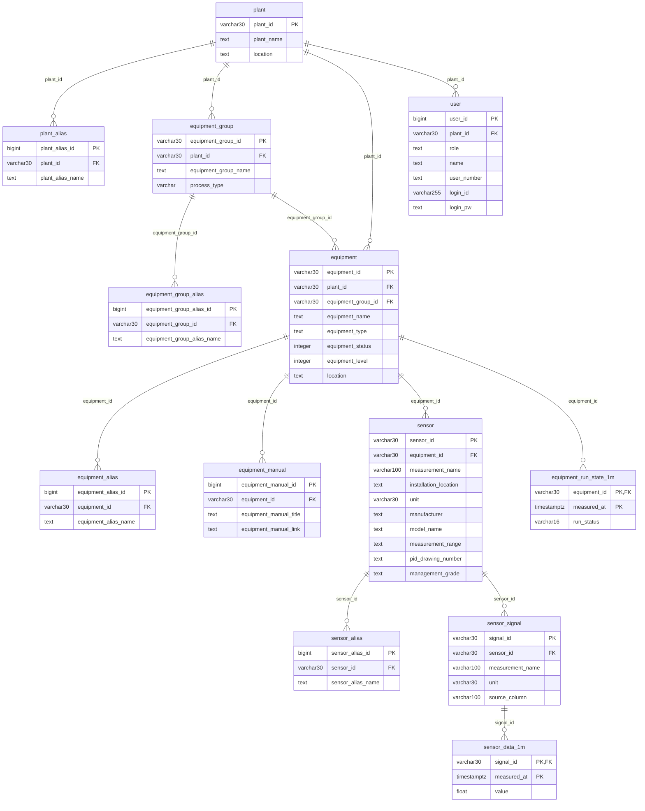
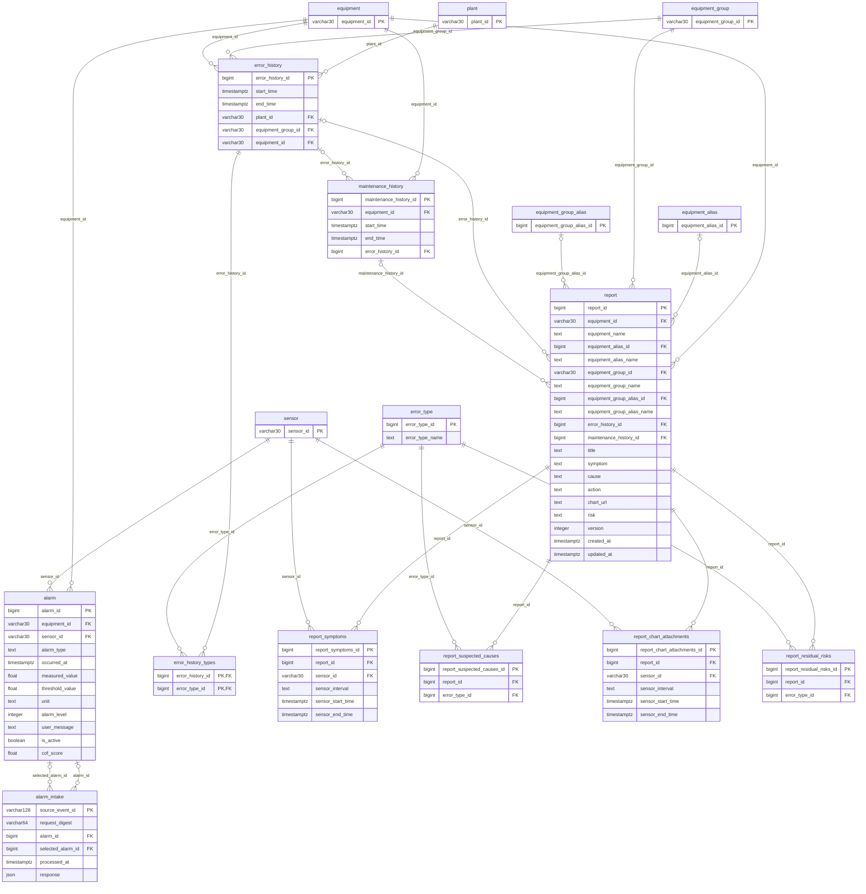
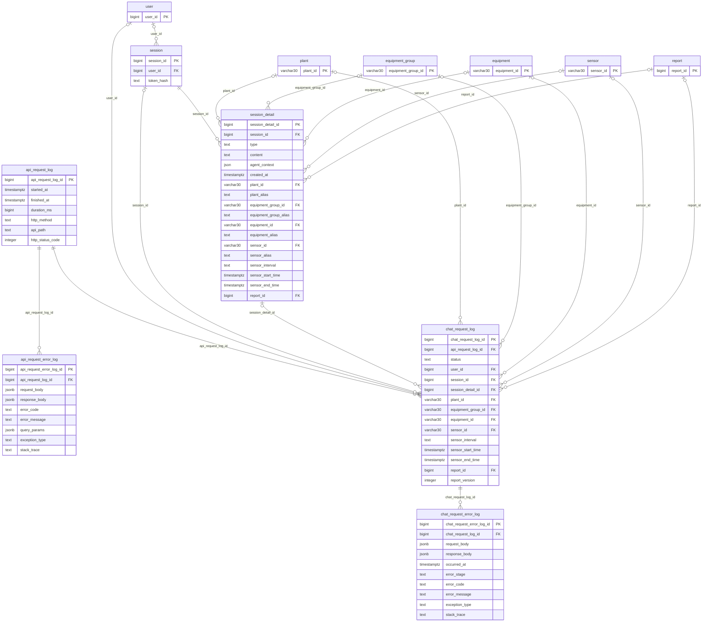

# SKADI 데이터베이스 ERD

기준: `BE/app/db/models.py`가 등록한 SQLAlchemy 메타데이터와 `BE/migrations/versions/`의 마이그레이션. PostgreSQL 17, TimescaleDB, pgvector를 사용한다. 이 문서는 애플리케이션의 최신 스키마 정의를 나타내며, 실행 중인 DB의 적용 리비전은 별도로 확인해야 한다.

표기: `PK`는 기본 키, `FK`는 외래 키다. 관계선은 부모 테이블에서 자식 테이블로 향한다. `||`는 필수 부모, `o|`는 선택 부모이며 자식 쪽 `o{`는 0개 이상을 뜻한다. 다른 도메인의 참조 테이블은 해당 그림에서 기본 키만 간략히 표시했다.

## 설비 계층과 계측

## 알람, 장애 이력, 보고서

## 채팅과 API 요청 로그

## 주요 제약과 해석

- `plant`, `equipment_group`, `equipment`, `sensor`, `sensor_signal`의 기본 키는 `varchar(30)` 코드다. 나머지 단일 숫자 기본 키는 대체로 `bigint` identity다.
- `sensor_data_1m`의 기본 키는 `(signal_id, measured_at)`, `equipment_run_state_1m`의 기본 키는 `(equipment_id, measured_at)`이다. 두 테이블은 `measured_at` 기준 7일 간격 TimescaleDB hypertable이다.
- `error_history_types`의 `(error_history_id, error_type_id)`는 복합 기본 키이며 장애 이력과 오류 유형의 다대다 연결 테이블이다.
- `user.login_id`는 유일하다. `sensor_signal`의 `(sensor_id, source_column)`도 유일하다. `alarm_intake.source_event_id`는 문자열 기본 키로 중복 수신을 식별한다.
- `equipment.equipment_status`와 `alarm.alarm_level`은 0~4, `equipment_run_state_1m.run_status`는 `RUNNING` 또는 `STOPPED`로 제한된다. `alarm.cof_score`가 있으면 유한한 값이어야 한다.
- `report`에는 설비 및 그룹 이름과 별칭이 참조 ID와 함께 저장된다. 이 문자열은 보고서에 남기는 값이며 별도의 FK가 아니다.
- `session.user_id`는 익명 세션을 위해 비울 수 있다. `alarm_intake`의 `alarm_id`와 `selected_alarm_id`는 각각 `alarm`을 선택적으로 참조한다.

## 스키마 확인

`DB/skadi_2026-11-17.dump`는 2026-11-17 시점의 백업이다. 이 백업에는 이후 코드에 추가된 `alarm_intake`, `alarm.is_active`, `alarm.cof_score`, `equipment_group.process_type`, `session_detail.agent_context`가 없다. 따라서 위 ERD는 백업의 과거 상태가 아니라 현재 코드의 목표 스키마다. 운영 DB와 일치 여부는 `alembic current` 및 실제 테이블 구조로 확인한다.
