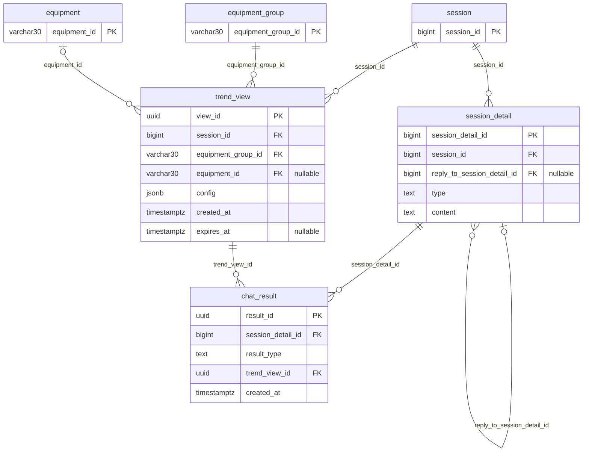

# SKADI 데이터베이스 ERD — 채팅 딥링크

기준: 실행 중인 `u3_2-db-1`의 `skadi` DB와 `DB/dump/skadi_20261119_add_trend_view.dump`(2026-11-19 02:01 KST 생성). 두 곳 모두 Alembic 리비전 `81e2b7c4d9a0`이다. 아래는 [2026-11-17 ERD](2026-11-17-설비,채팅.md)에 추가된 딥링크 관련 구조다. 덤프의 테이블·제약·인덱스 목록과 실행 DB의 정의를 대조했다.

## 관계

`session_detail.reply_to_session_detail_id`는 AI 응답이 원본 질문을 가리키는 자기 참조다. 복합 FK `(session_id, reply_to_session_detail_id) → session_detail(session_id, session_detail_id)`가 같은 세션의 메시지만 참조하게 한다. 참조 열은 nullable이므로 모든 메시지에 원본 질문이 있는 것은 아니다. `chat_result`는 AI 응답과 저장된 조회 설정을 연결한다. `/trend?viewId=<UUID>`는 `trend_view.view_id`를 사용하는 URL이며 DB에 URL 문자열을 별도로 저장하지 않는다.

## 추가·변경된 테이블

| 테이블 | 열 | 의미 |
| --- | --- | --- |
| `session_detail` | `reply_to_session_detail_id bigint NULL` | 원본 메시지 ID. `type='llm'`인 행에서만 값 허용 |
| `trend_view` | `view_id uuid PK DEFAULT gen_random_uuid()` | 딥링크가 여는 조회 설정 ID |
|  | `session_id bigint NOT NULL FK` | 소유 채팅 세션 |
|  | `equipment_group_id varchar(30) NOT NULL FK` | 조회 대상 설비 그룹 |
|  | `equipment_id varchar(30) NULL FK` | 특정 설비. `NULL`이면 그룹 범위 |
|  | `config jsonb NOT NULL` | 버전, 센서별 조회 기간, 이상 구간 표시 여부 |
|  | `created_at timestamptz NOT NULL DEFAULT now()` | 생성 시각 |
|  | `expires_at timestamptz NULL` | 선택적 만료 시각 |
| `chat_result` | `result_id uuid PK DEFAULT gen_random_uuid()` | 결과 연결 ID |
|  | `session_detail_id bigint NOT NULL FK` | 결과를 생성한 메시지 |
|  | `result_type text NOT NULL` | 현재 `trend`만 허용 |
|  | `trend_view_id uuid NOT NULL FK` | 연결된 조회 설정 |
|  | `created_at timestamptz NOT NULL DEFAULT now()` | 연결 생성 시각 |

`config`는 JSON 객체이며 최상위 `version`은 숫자, `series`는 배열, `showAnomalies`는 불리언이어야 한다. 각 `series` 원소는 `sensorId`, `start`, `end`를 담는다. 센서별 기간은 절대 시각으로 저장한다. DB CHECK는 최상위 형식까지만 검사하며, 센서의 소속과 기간의 유효성은 BE에서 검증한다. `config.series[].sensorId`는 JSON 안의 값이라 `sensor`에 대한 DB FK가 없다.

## 제약과 인덱스

- `session_detail`: `UNIQUE(session_id, session_detail_id)`가 복합 자기 참조의 대상 키다. `reply_to_session_detail_id IS NULL OR type='llm'` CHECK와 `ix_session_detail_reply_to` 인덱스가 추가됐다.
- `trend_view`: `session`, `equipment_group`, 선택적 `equipment` FK가 있다. `config` 객체·필수 키의 JSON 타입, `expires_at > created_at`을 CHECK로 제한한다. `ix_trend_view_session_created(session_id, created_at)`가 있다.
- `chat_result`: `session_detail`, `trend_view` FK와 `result_type='trend'` CHECK가 있다. `UNIQUE(session_detail_id, trend_view_id)`로 동일 메시지·View 연결의 중복을 막고, `ix_chat_result_trend_view(trend_view_id)`가 있다.
- DB는 `chat_result.session_detail_id`의 대상이 실제 `type='llm'`인지, `chat_result`의 메시지와 View가 같은 세션인지, `trend_view.equipment_id`가 지정 그룹에 속하는지까지 강제하지 않는다. 현재 생성 API가 이 조건을 검증한다.

## 적용 상태와 범위

- 실행 DB 조회 시 `session_detail` 58행, `trend_view` 0행, `chat_result` 0행이었다. 구조 적용은 확인됐지만 저장된 딥링크 데이터는 아직 없다.
- 2026-11-18 덤프에는 `trend_view`, `chat_result`, 답장 자기 참조가 없고, 이번 덤프에는 포함된다.
- 기존 `report_chart_attachments`에는 `trend_view_id`가 없다. 보고서와 View의 관계는 이번 스키마에 포함되지 않는다.
