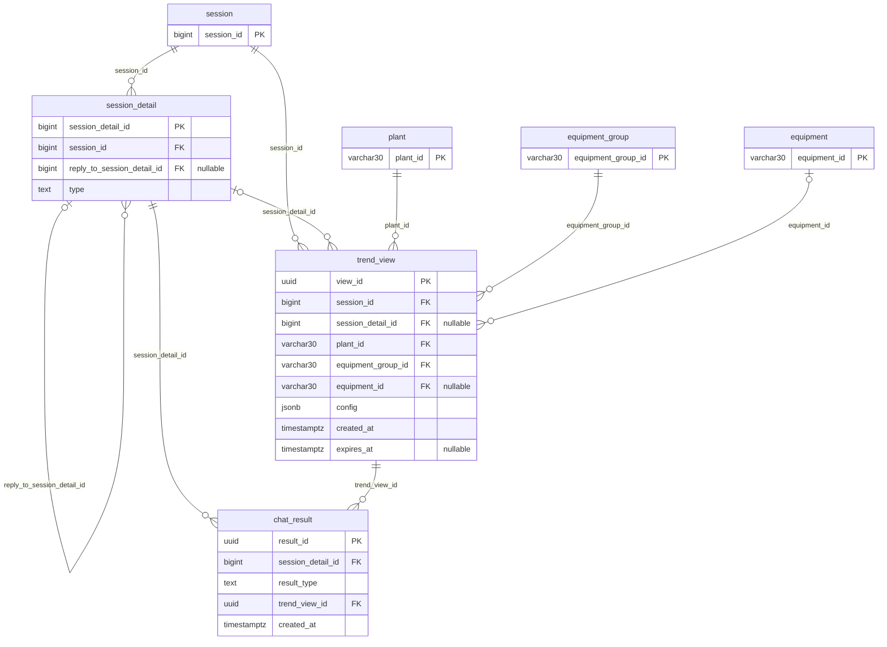

# SKADI 데이터베이스 ERD — 트렌드 View 생성 메시지

기준: [skadi_20261119_1347_update_trend_view.dump](../dump/skadi_20261119_1347_update_trend_view.dump), 2026-11-19 13:47 KST 생성. Alembic 리비전은 `5e1c8a42d7b0`이다. [이전 딥링크 ERD](2026-11-19-딥링크.md) 이후 `trend_view.plant_id`와 `trend_view.session_detail_id`가 추가된 구조를 기록한다. 덤프 목록과 실행 DB의 열·제약·인덱스를 확인했다.

## 관계

`trend_view.session_detail_id`는 View를 생성한 AI 응답을 가리킨다. 복합 FK `(session_id, session_detail_id) → session_detail(session_id, session_detail_id)`가 같은 채팅 세션의 메시지만 참조하게 한다. 메시지 없이 생성한 View에는 `NULL`을 허용한다. `chat_result`는 메시지의 결과 목록과 View를 연결하는 별도 테이블로 유지한다.

## `trend_view` 열

| 열 | 타입·제약 | 의미 |
| --- | --- | --- |
| `view_id` | `uuid PK DEFAULT gen_random_uuid()` | `/trend?viewId=<UUID>`의 식별자 |
| `session_id` | `bigint NOT NULL FK` | 소유 채팅 세션 |
| `session_detail_id` | `bigint NULL`, 복합 FK | View를 생성한 응답 메시지 |
| `plant_id` | `varchar(30) NOT NULL FK` | 플랜트 |
| `equipment_group_id` | `varchar(30) NOT NULL FK` | 설비 그룹 |
| `equipment_id` | `varchar(30) NULL FK` | 특정 설비. `NULL`이면 그룹 범위 |
| `config` | `jsonb NOT NULL` | 버전, 센서별 절대 조회 기간, 이상 구간 표시 여부 |
| `created_at` | `timestamptz NOT NULL DEFAULT now()` | 생성 시각 |
| `expires_at` | `timestamptz NULL` | 선택적 만료 시각 |

`session_detail_id` 추가 마이그레이션은 기존 `chat_result`에서 View에 연결된 메시지가 하나로 확정되는 경우 해당 ID를 채운다. 여러 메시지에 연결된 View는 생성 메시지를 단정할 수 없어 `NULL`로 남긴다. `plant_id`는 앞선 마이그레이션에서 설비 그룹의 플랜트로 채웠다.

## 제약·인덱스와 적용 상태

- `trend_view`에는 `view_id` PK, `session`, `plant`, `equipment_group`, 선택적 `equipment` FK와 새 복합 메시지 FK가 있다.
- `config`가 JSON 객체이며 `version`은 숫자, `series`는 배열, `showAnomalies`는 불리언인지 CHECK로 확인한다. `expires_at`이 있으면 `created_at`보다 늦어야 한다.
- `ix_trend_view_session_created(session_id, created_at)` 인덱스가 있다. 새 메시지 FK에 대한 별도 인덱스는 없다.
- 덤프 생성 후 실행 DB 확인 시 `trend_view` 3행, `chat_result` 3행이며 `trend_view.session_detail_id`가 채워진 View는 3행이었다.
- DB는 참조한 메시지의 `type='llm'` 여부, 설비가 지정 그룹에 속하는지, `chat_result`와 View가 같은 세션인지까지 강제하지 않는다. 생성 API에서 해당 조건을 검증한다.
