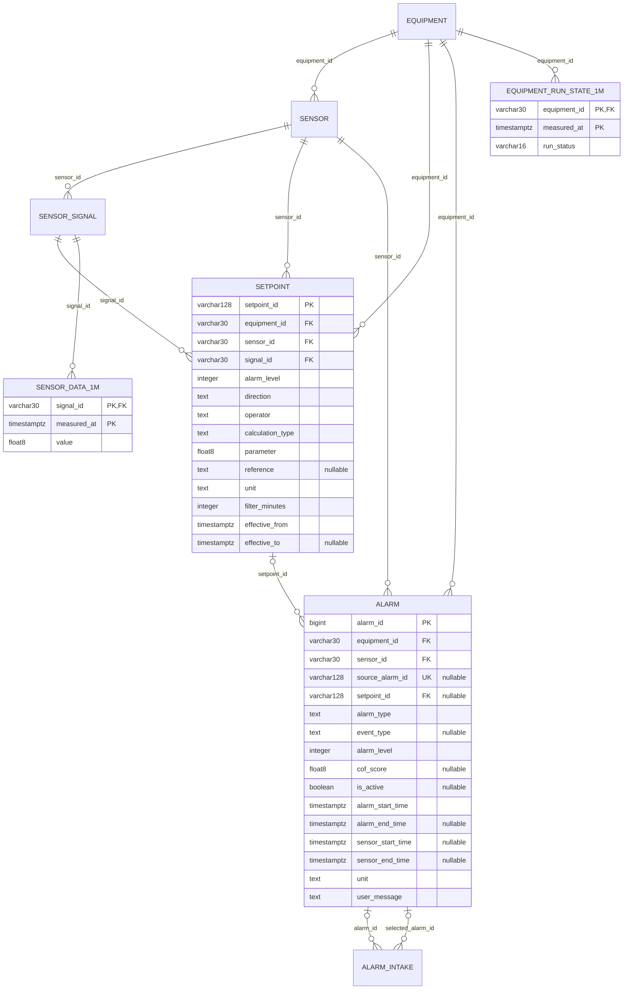

# SKADI 데이터베이스 ERD — 알람과 Setpoint

2026-11-19 14:49:19 KST 개발 DB의 스키마와 데이터 상태를 기록한다. Alembic 리비전은 `ab27c93e4501`이며, 이전 리비전은 `5e1c8a42d7b0`이다. 표의 열·제약·적재 건수와 적용 후 덤프는 같은 PostgreSQL 스냅샷을 기준으로 확인했다. [적용 후 덤프](../dump/skadi_20261119_144919_update_alarm_setpoints.dump) · [적용 전 백업](../dump/skadi_20261119_144310_pre_alarm_fixture.dump) · [이전 ERD](skadi_20261119_1347_update_trend_view.md)

## 관계

## 스키마 변경

| 테이블 | 변경 | 적용 내용 |
| --- | --- | --- |
| `setpoint` | 신규 | 버전이 포함된 `setpoint_id`를 PK로 사용한다. 설비·센서·신호를 FK로 참조하고, 등급·비교 방향·계산 방식·유효 기간을 저장한다. |
| `alarm` | 열 변경 | `occurred_at`을 `alarm_start_time`으로 이름을 바꿔 기존 시각을 보존했다. `measured_value`와 `threshold_value`를 제거했다. |
| `alarm` | 열 추가 | 원본 문자열 ID `source_alarm_id`(UNIQUE), `setpoint_id`(FK), `event_type`, 조치 완료 시각 `alarm_end_time`, 실제 초과 시작·복귀 시각 `sensor_start_time`·`sensor_end_time`을 추가했다. 새 열은 기존 이력을 위해 NULL을 허용한다. |
| `sensor_data_1m`, `equipment_run_state_1m` | 데이터 교체 | 기존 테이블 구조에서 P1~P6의 전 기간 행을 2026년 11월 CSV 데이터로 교체했다. |

- `setpoint`의 유효 구간은 `[effective_from, effective_to)`다. `effective_to = NULL`은 종료일 없이 유효함을 뜻한다. 종료일이 있으면 시작일보다 늦어야 한다. `btree_gist`를 사용하는 `setpoint_no_overlap` 제약이 같은 센서·방향·등급의 유효 기간 중첩을 막는다.
- Setpoint 등급은 1~4이며, 방향과 연산자는 `HIGH >=`, `LOW <=`로 짝을 맞춘다. `filter_minutes`는 양수다. `FIXED`의 참조 코드는 NULL이며, `BASELINE_RATIO`·`BASELINE_OFFSET`·`EXPECTED_OFFSET`에는 참조 코드가 필요하다.
- 적재한 알람의 범주(`alarm_type`)는 `Setpoint`이며, 원본 발생 유형(`event_type`)은 `예측` 또는 `임계치 초과`다. 알람의 조치 완료, 센서 복귀, 실제 해제는 별개다. CSV에 실제 해제 정보가 없어 적재한 알람 10건의 `is_active`는 모두 NULL이다.

## 적용 결과

시계열 기간은 2026-11-01 00:00부터 2026-11-30 23:59까지 KST다. 펌프마다 8개 센서 신호와 43,200분의 운전 상태를 적재했다.

| 설비 | 센서값 | 운전 상태 | Setpoint | CSV 알람 |
| --- | ---: | ---: | ---: | ---: |
| P1 | 345,600 | 43,200 | 44 | 4 |
| P2 | 345,600 | 43,200 | 44 | 2 |
| P3 | 345,600 | 43,200 | 44 | 2 |
| P4 | 345,600 | 43,200 | 44 | 2 |
| P5 | 345,600 | 43,200 | 44 | 0 |
| P6 | 345,600 | 43,200 | 44 | 0 |
| 합계 | 2,073,600 | 259,200 | 264 | 10 |

CSV 알람은 예측 6건, 임계치 초과 4건이다. 적용 직후 시각·센서값·운전 상태를 원본 CSV와 행 단위로 대조했다. 덤프는 `pg_dump -Fc`로 생성했고, `pg_restore --list` 및 전체 아카이브 읽기 검증을 통과했다. 실제 복원 검증은 별도다.
