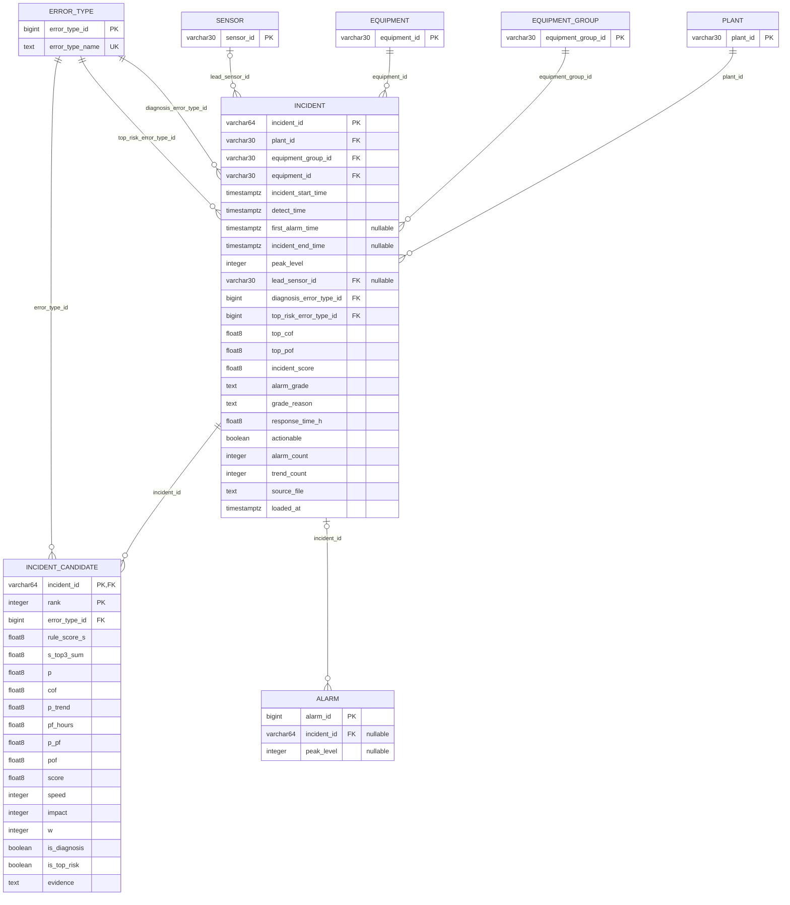

# SKADI 데이터베이스 ERD — 이상 사건(Incident)

기준: [skadi_20261120-094247_add_incident.dump](../dump/skadi_20261120-094247_add_incident.dump)의 스키마와 데이터. Alembic 리비전은 `c8e1f5a3b7d2`이며, 직전 [2026-11-19 16:14 덤프](../dump/skadi_20261119_161433.dump)와 비교했다. 아래는 이전 [알람·Setpoint ERD](skadi_20261119_144919_update_alarm_setpoints.md) 이후 추가된 관계다. 이 문서는 덤프의 상태를 기록하며 실행 중인 DB의 현재 상태를 뜻하지 않는다.

## 관계

`incident`는 분석기가 판정한 이상 사건이고, 기존 `error_history`는 확정된 고장 이력이다. 이번 덤프에는 둘을 잇는 FK가 없다. `incident`의 진단 원인과 최고 위험 원인은 각각 `error_type`을 참조한다. 후보는 `(incident_id, rank)`가 복합 PK이고, 사건을 삭제하면 해당 후보도 `ON DELETE CASCADE`로 삭제된다. 알람은 `incident_id`로 사건 하나를 선택적으로 참조한다. `lead_sensor_id`도 선택적 참조다.

## 스키마 변경과 제약

| 대상 | 덤프에서 확인한 변경 |
| --- | --- |
| `incident` | 신규 테이블. 사건 ID, 설비 계층, 발생·감지·첫 알람·종료 시각, 최고 등급, 선행 센서, 진단·최고 위험 고장 유형, CoF·PoF·점수, 대응 정보와 건수를 저장한다. |
| `incident_candidate` | 신규 테이블. 사건별 순위와 원인 유형, 규칙·확률·위험 점수, 진단·최고 위험 여부, 근거를 저장한다. |
| `alarm` | `incident_id varchar(64) NULL` FK와 `peak_level integer NULL` 추가. 기존 `alarm_level`은 유지한다. |
| `error_type` | `error_type_name`에 `uq_error_type_name` UNIQUE 제약 추가. |

- `incident.peak_level`과 `alarm.peak_level`은 0~4로 제한한다. `incident.detect_time >= incident_start_time`이며 종료 시각이 있으면 시작보다 늦어야 한다. 사건의 `alarm_count`와 `trend_count`는 음수가 될 수 없다.
- 사건의 `top_cof`, `top_pof`, `incident_score`, `response_time_h`, 후보의 `cof`, `pof`, `score`는 유한한 값이어야 한다. 후보 `rank`는 1 이상이다.
- 부분 UNIQUE 인덱스 `uq_incident_candidate_diagnosis`와 `uq_incident_candidate_top_risk`는 사건마다 각 표시가 참인 후보를 **최대 1건**으로 제한한다. 각 1건이 반드시 존재하는지는 DB 제약으로 보장하지 않는다.
- 조회용 인덱스는 `ix_incident_equipment_start(equipment_id, incident_start_time DESC)`와 `ix_alarm_incident(incident_id)`다.
- 각 ID의 FK는 존재 여부를 보장하지만, 사건의 설비가 지정 그룹·플랜트에 속하는지, 선행 센서와 연결 알람의 센서가 같은 설비에 속하는지, `alarm_count`가 연결 행 수와 같은지까지 DB 제약으로 보장하지 않는다.

## 덤프 데이터

| 항목 | 건수·상태 |
| --- | --- |
| `incident` | 4건: P1~P4 각 1건 |
| `incident_candidate` | 10건: P1 3, P2 3, P3 1, P4 3. 진단 표시 4건, 최고 위험 표시 4건 |
| `alarm` | 10건: P1 4, P2 2, P3 2, P4 2. 모두 `incident_id`와 `peak_level`이 채워져 있다. `alarm_level`은 모두 2, `peak_level`은 2가 3건·3이 7건이다. `is_active`는 모두 NULL이다. |
| `error_type` | 6건: 베어링 마모, 임펠러 마모, 임펠러 불균형, 축 정렬 불량, 캐비테이션, 커플링 마모 |
| `setpoint` | 264건 |

사건의 `alarm_count`는 P1~P4 순서로 4·2·2·2이고 덤프의 알람 연결 수와 같다. `trend_count`는 4·2·3·1로 저장돼 있지만, 이번 스키마에는 `incident`에서 `trend_view`로 가는 FK가 없다. 사건과 후보의 `source_file`·`evidence`는 합성 fixture의 출처와 진단 근거를 기록한다.

`pg_restore -s`로 추출한 스키마를 직전 덤프와 비교했고, 위 건수는 덤프의 해당 `COPY` 데이터를 기준으로 확인했다. 시계열은 TimescaleDB 청크에 저장되므로 테이블 이름만 지정한 `pg_restore -t sensor_data_1m` 조회 결과를 시계열 총건수로 해석하지 않았다. 실제 복원이나 실행 DB 조회는 이 문서의 검증 범위에 포함되지 않는다.
