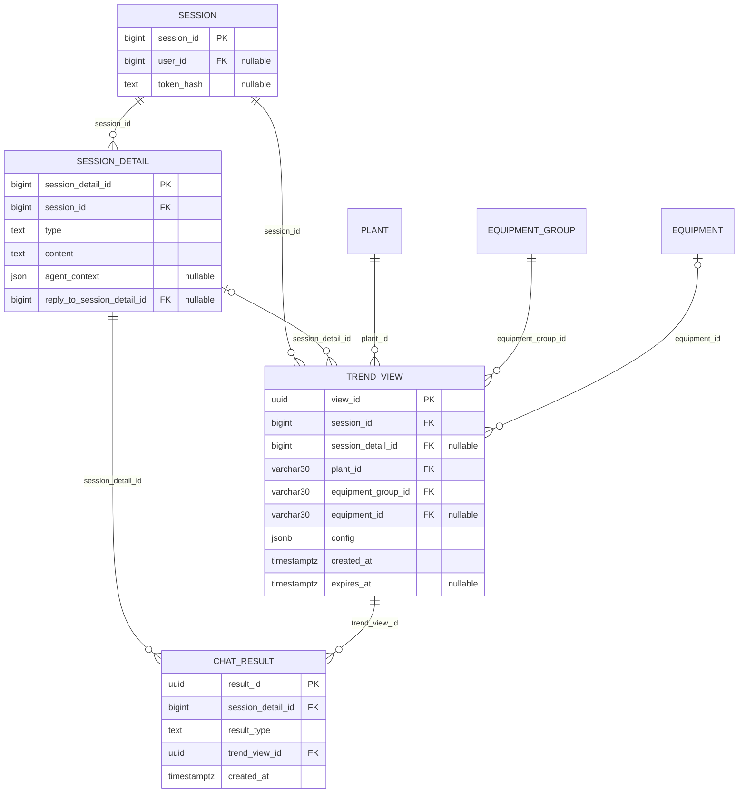

# SKADI 데이터베이스 ERD — 2026-11-20 14:00 덤프

기준: [skadi_20261120-140035.dump](../dump/skadi_20261120-140035.dump)를 별도 DB에 복원해 확인한 스키마와 데이터. 이전 [09:42 덤프 ERD](skadi_20261120-094247_add_incident.md)와 비교했다. 덤프의 Alembic 리비전은 `d7f3b2a9c610`이고, 현재 실행 DB는 두 마이그레이션 분기를 병합하는 `8c6d14e0b3a2`까지 적용했다. 아래 건수는 복원 직후 기준이다.

## 관계

이번 덤프에서 건수가 늘어난 채팅 관련 테이블의 관계다. 이상 사건과 알람 관계는 이전 ERD와 같다.

`trend_view`가 메시지를 참조할 때는 `(session_id, session_detail_id)` 복합 FK로 같은 세션의 메시지만 연결한다. `session_detail`의 답장 참조에도 같은 세션을 강제하는 복합 FK가 있다. `chat_result.result_type`은 현재 `trend`만 허용한다.

## 스키마 비교

두 덤프의 `pg_restore -s --no-owner --no-acl` 출력에서 아카이브마다 임의로 생성되는 `\restrict` 토큰을 제외하면 스키마 차이가 없다. 공개 스키마에는 테이블 36개가 있다. 따라서 이 덤프 적용은 새 테이블이나 열을 추가하는 작업이 아니라 데이터 스냅샷 교체다. PostgreSQL 17.11, TimescaleDB 2.32.0, pgvector 0.8.7 환경에서 복원했다.

## 데이터 비교

| 테이블 | 이전 실행 DB `skadi` | 새 덤프 복원 DB |
| --- | ---: | ---: |
| `session` | 9 | 10 |
| `session_detail` | 70 | 156 |
| `trend_view` | 4 | 11 |
| `chat_result` | 4 | 11 |
| `api_request_log` | 35 | 78 |
| `chat_request_log` | 35 | 78 |
| `incident` | 4 | 4 |
| `incident_candidate` | 10 | 10 |
| `alarm` | 10 | 10 |
| `setpoint` | 264 | 264 |
| `sensor_data_1m` | 2,073,600 | 2,073,600 |
| `equipment_run_state_1m` | 259,200 | 259,200 |

새 덤프에도 P1~P4 사건이 각 1건 있으며 후보 10건 중 진단 표시 4건, 최고 위험 표시 4건이다. 알람 10건은 사건에 연결돼 있고 `is_active`는 모두 NULL이다. 주요 설비·센서 데이터 건수는 이전 DB와 같다. 위 수치는 `COPY` 목록 추정치가 아니라 복원 DB에서 조회한 실제 행 수다.

## 적용 기록

기존 실행 DB는 [전환 전 백업](../dump/skadi_before_20261120-140035_switch.dump)으로 보관했다. 새 덤프를 `skadi_20261120_140035` DB에 복원하고, 충돌하던 Alembic 분기를 [병합 리비전](../../BE/migrations/versions/8c6d14e0b3a2_merge_restored_db_heads.py)으로 연결했다. 병합 마이그레이션은 데이터나 테이블을 변경하지 않는다. 실행 환경의 `POSTGRES_DB`를 새 DB로 전환한 뒤 Alembic 리비전 `8c6d14e0b3a2`와 주요 행 수를 확인했다.
