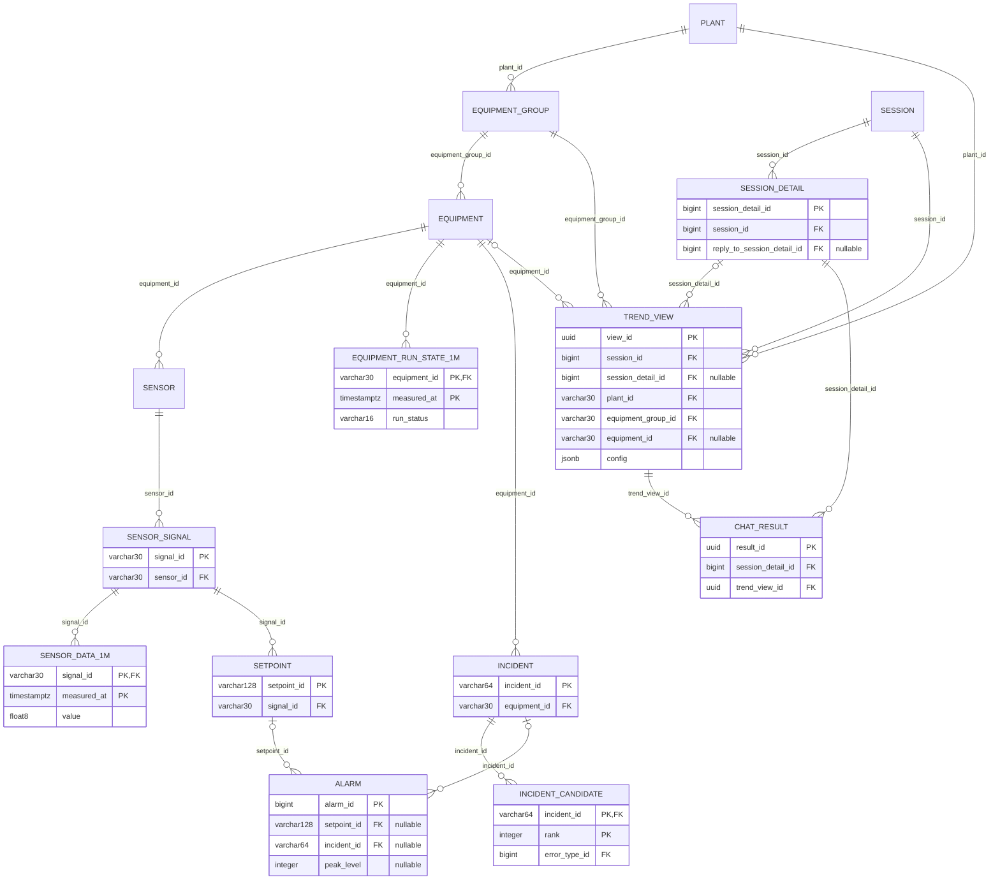

# SKADI 데이터베이스 ERD — 2026-11-20 16:14 덤프

기준: [skadi_20261120-161415.dump](../dump/skadi_20261120-161415.dump), 2026-11-20 16:14:15 KST 생성. 덤프의 스키마와 `COPY` 데이터를 읽어 [14:00 덤프 ERD](skadi_20261120-140035.md)와 비교했다. 덤프의 Alembic 리비전은 `8c6d14e0b3a2`다. 실행 DB `skadi_restore`도 같은 리비전이며, 2026-11-20 16:17:11 KST에 주요 행 수와 시계열 기간을 교차 확인했다.

## 관계

시계열 조회, 이상 사건, 채팅에서 저장한 트렌드의 주요 연결이다. 이번 덤프에서 새 관계가 추가되지는 않았다. 아래 엔티티에는 연결에 필요한 키만 표시한다. 전체 Incident 열과 제약은 [이상 사건 ERD](skadi_20261120-094247_add_incident.md), Setpoint 열과 제약은 [알람·Setpoint ERD](skadi_20261119_144919_update_alarm_setpoints.md)를 참고한다.

`trend_view`의 생성 메시지와 `session_detail`의 답장 메시지는 각각 복합 FK로 같은 세션에 속하도록 제한한다. `chat_result`는 메시지와 저장된 트렌드 View를 연결하며 `(session_detail_id, trend_view_id)` 중복을 금지한다. `incident`와 `trend_view` 사이에는 직접 FK가 없다.

## 스키마 비교

14:00 덤프와 16:14 덤프의 `pg_restore --schema-only --no-owner --no-acl` 출력을 비교했다. 아카이브별 `\restrict`·`\unrestrict` 토큰을 제외하면 출력이 같다. 공개 스키마의 테이블은 36개이며, 이번 덤프에는 테이블·열·제약·인덱스 변경이 없다.

Alembic 리비전은 `d7f3b2a9c610`에서 `8c6d14e0b3a2`로 바뀌었다. [병합 리비전](../../BE/migrations/versions/8c6d14e0b3a2_merge_restored_db_heads.py)은 `2f9b0a8e6c31`과 `d7f3b2a9c610` 분기를 연결하며, `upgrade()`와 `downgrade()` 모두 DDL이나 데이터 변경을 수행하지 않는다.

실행 환경은 PostgreSQL 확장 TimescaleDB `2.32.0`, pgvector `0.8.7`, `btree_gist` `1.7`이다. `timescaledb.restoring`은 `off`로 확인했다.

## 데이터 비교

이전 건수는 14:00 덤프 ERD의 복원 직후 기록이고, 이번 건수는 16:14 덤프의 데이터를 집계한 결과다.

| 테이블 | 14:00 덤프 | 16:14 덤프 | 증감 |
| --- | ---: | ---: | ---: |
| `session` | 10 | 10 | 0 |
| `session_detail` | 156 | 298 | +142 |
| `trend_view` | 11 | 16 | +5 |
| `chat_result` | 11 | 16 | +5 |
| `api_request_log` | 78 | 149 | +71 |
| `chat_request_log` | 78 | 149 | +71 |
| `incident` | 4 | 4 | 0 |
| `incident_candidate` | 10 | 10 | 0 |
| `alarm` | 10 | 10 | 0 |
| `setpoint` | 264 | 264 | 0 |
| `sensor_data_1m` | 2,073,600 | 2,073,600 | 0 |
| `equipment_run_state_1m` | 259,200 | 259,200 | 0 |

16:14 덤프의 플랜트는 1개, 설비 그룹은 1개, 설비는 6개다. 센서와 신호는 각각 48개다. 사건은 P1~P4 각 1건이며 후보 10건 중 진단 표시는 4건, 최고 위험 표시는 4건이다. 알람 10건은 모두 사건에 연결돼 있고 `is_active`는 모두 NULL이다. 보고서·고장 이력·정비 이력과 API·채팅 오류 로그는 각각 0건이다.

## 시계열 저장과 검증

두 시계열 테이블의 기간은 모두 **2026-11-01 00:00~2026-11-30 23:59 KST**다. TimescaleDB hypertable별 청크는 각각 54개이며 총 108개다.

덤프의 `public.sensor_data_1m`과 `public.equipment_run_state_1m` 자체 `COPY` 행은 0건이지만, 실제 데이터는 자식 청크에 저장돼 있다. 스키마의 `INHERITS` 관계를 확인하고 `_hyper_1_*` 청크의 센서값 2,073,600건과 `_hyper_2_*` 청크의 운전 상태 259,200건을 합산했다. 부모 테이블만 지정한 `pg_restore -t` 결과를 전체 시계열 건수로 해석하지 않는다.

실행 DB `skadi_restore`에서는 읽기 전용 `REPEATABLE READ` 트랜잭션으로 두 부모 테이블의 실제 `count(*)`와 최소·최대 시각을 조회했다. 시계열 건수·기간, 채팅 세션·메시지·트렌드 View·결과 및 요청 로그 건수는 덤프 집계와 일치했다. 이번 기록을 위해 새 DB에 재복원하거나 서비스의 연결 설정을 변경하지는 않았다. 복원 및 서비스 연결 절차는 [DUMP.md](../../DUMP.md)를 참고한다.
